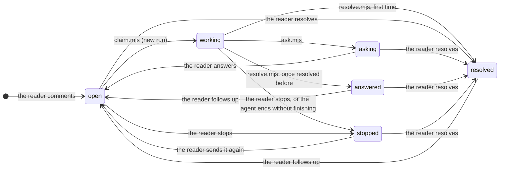

# The comments file and the step files

Annotant keeps two kinds of files for a project:

| File | Where | Holds | Written by |
| --- | --- | --- | --- |
| `comments.json` | In the project, at `commentsFile` of `.annotant.json` (`.annotant/comments.json` by default; `ANNOTANT_COMMENTS_FILE` overrides it) | The discussions: every comment, its thread, its state and the history of its moves | The store (`scripts/lib/store.mjs`), for the server and the agents' scripts |
| `<id>.jsonl` | In the state folder, `<state>/<hash>/progress/` | The steps of the run in progress on comment `<id>` | The hooks (`hooks/register.ts`) |
| `<id>.history.jsonl` | Next to it | The steps of every run that ended, with a dev build of the widget only | The store, when a run ends |
| `images/<id>/m<n>-<k>.<ext>` | Beside `comments.json` | The images the reader attached to message `m<n>` of comment `<id>` | The store, from the widget's request |
| `diffs/<id>/<run>/<key>.json` | Beside `comments.json` | A file of the repository run `<run>` of comment `<id>` changed, before its first write and after its last | The hooks, around the run's writes |

`<state>` is `ANNOTANT_STATE_DIR`, else `$XDG_CACHE_HOME/annotant`, else
`~/.cache/annotant`. `<hash>` is the first 12 hex digits of the SHA-1 of the
project's root: each project has its own folder. Deleting a comment deletes
its step files, its images and its diffs; `comments.json` never holds a step,
an image's bytes nor a file's content.

The reference for the comments file is
[`skills/annotant/scripts/lib/format.mjs`](../skills/annotant/scripts/lib/format.mjs):
its version, states, moves and JSDoc types. The widget mirrors them in
`skills/annotant/widget/src/domain.ts`.

## `comments.json`

### The envelope

```jsonc
{ "version": 2, "comments": [ /* Comment, oldest first */ ] }
```

Any other `version`, or a bare array (version 1), is refused and left
untouched: the server stops with
`COMMENTS_REFUSED old comments format: delete <file>`, and the scripts print
the same message.

### A comment

```jsonc
{
  "id": "b96fae58-5cc3-426b-9632-77f3a7f8f866",
  "route": "/",                              // "*": about the whole app
  "url": "http://localhost:5190/",           // the page and its query, no hash
  "anchor": {
    "section": "Coffee roasted the week you drink it", // the heading above it
    "quote": "",                             // the selected text; "" when none
    "occurrence": 0,                         // which occurrence of the quote
    "element": {                             // when the reader pointed at one
      "selector": "#root > main > section:nth-of-type(1) > h1",
      "tag": "h1",
      "text": "Coffee roasted the week you drink it",
      "html": "<h1>Coffee roasted the week you drink it</h1>"
    }
  },
  "state": "resolved",                       // always the last event's
  "createdAt": "2026-10-10T15:44:37.597Z",   // equals messages[0].at
  "messages": [ /* Message */ ],
  "events": [ /* Event */ ],
  "cancellation": { /* the last stopped run, when there is one */ },
  "writes": [ /* Write: where each run changed files, in git */ ]
}
```

| Field | Type | Notes |
| --- | --- | --- |
| `id` | string | A UUID. |
| `route` | string | The page's path, or `*` for the whole app. |
| `url` | string, optional | An `http` or `https` URL, up to 2000 characters, without credentials or hash; the server drops any other, and replaces the values of its secret-looking parameters (`token`, `code`, `session`…), in the query or the path (`;jsessionid=…`), with `redacted`. |
| `anchor.section` | string | Up to 300 characters. |
| `anchor.quote` | string | Whitespace-collapsed, up to 2000 characters. |
| `anchor.occurrence` | integer ≥ 0 | |
| `anchor.prefix`, `anchor.suffix` | string, optional | With a quote: the page's text just before and after it, up to 32 characters, whitespace collapsed, a line break where a block ends. |
| `anchor.occurrences` | integer ≥ 1, optional | With a quote: how many copies of it the page had. |
| `anchor.element` | object, optional | `selector` (500), `tag` (20), `text` (200) and `html` (600), truncated. The server leaves out of `html` the `value` and `content` attributes and the secret-looking ones (`nonce`, `data-token`…), and redacts the secret-looking parameters of its links (`href`, `src`, `srcset`, `data-*`…). |
| `anchor.area` | object, optional | A rectangle drawn over the page, or the box of a drawing: its box, the `viewport`, the element it lies `within`, the elements it `covers` (10) and `crosses` (6), `truncated`. A drawing adds `strokes`: up to 40 lines, the last ones drawn, of up to 400 `[x, y]` points each and 4000 in all, rounded, from the area's corner and inside its box, its `covers` and `crosses` those of a wider box (a quarter of its size more on each side, 120 px at least, never past the window's edges) so what an arrow points at is in; `pointsAt`, the element the longest line points at: under its end, where an arrowhead usually is, or past a gap the next one along the line, never a container holding the whole drawing; `around`, the element the lines are placed from (the largest element wholly in their box, else the one they point at), with where the box's corner lies from its corner, its scroll aside (`offset`), and its `size`: the widget places the lines from it, their left offset and width scaled to its width, not their height; hidden, it hides them; gone, `within` places them; `pictured` (`true`) when the last image of the comment's first message is their picture, the lines over the page close to how the reader saw it (colours, text, same-origin images, close to their stacking order and cut as on screen; no SVG, video, rotated boxes or clip-path). |
| `state` | State | See [States](#states-and-moves). |
| `createdAt` | ISO date | Lists sort by it. |
| `messages` | Message[] | The whole thread, the reader's comment first. |
| `events` | Event[] | Every move, oldest first, never overwritten. |
| `cancellation` | Cancellation, optional | Kept after a re-send, so the next agent sees it. |
| `writes` | Write[], optional | Where each run that changed files wrote them (see [A write](#a-write)). |

The widget finds a quote on the only copy the page still reads around as
`prefix` and `suffix` say (both sides, in full or by their part in the quote's
own block); else, while the page has `occurrences` copies, on the one at
`occurrence`; else nowhere: the comment shows as detached, never on another
copy.

### A message

```jsonc
{ "id": "m1", "author": "reader", "body": "change le titre", "at": "…",
  "sentAt": "…", "notifiedAt": "…" }
{ "id": "m2", "run": "r1", "author": "claude", "question": true,
  "body": "Quel nouveau titre veux-tu ?",
  "options": [{ "label": "Café torréfié la semaine où tu le bois", "description": "traduction en français" }],
  "at": "…" }
{ "id": "m3", "author": "reader", "body": "Café torréfié la semaine où tu le bois",
  "choices": ["Café torréfié la semaine où tu le bois"], "at": "…", "sentAt": "…" }
{ "id": "m4", "run": "r2", "author": "claude", "body": "Le titre est changé.",
  "changed": ["src/pages/Home.tsx"], "at": "…" }
```

| Field | Type | Notes |
| --- | --- | --- |
| `id` | `m1`, `m2`… | In sequence within the comment. |
| `author` | `reader` or `claude` | |
| `body` | string | |
| `at` | ISO date | |
| `run` | `r1`, `r2`…, Claude only | The run that wrote it. |
| `question` | `true`, Claude only | A question rather than an answer. |
| `options` | `{ label, description? }[]`, a question only | 2 to 6, distinct labels; the reader may answer in their own words instead. |
| `multiple` | `true`, with `options` | The reader may pick several. |
| `changed` | string[], Claude only | The files the run it closes (an answer or a question) changed, each once: those its file tools wrote (`edit`, `write`, `multiedit`, not failed; a write from Bash is refused) and those `rm`, `git rm` or `unlink` deleted (`delete` steps). Relative to the project (`../api/x.ts` out of it, in the repository), a file outside the repository by its absolute path, a deleted folder with a `/` at its end (the files the run changed in it left out); absent when it changed none. The widget lists them under the message, folded into a count past one, each with the lines the run added and removed (see [Diffs](#diffs)), a click on it showing its diff, a button copying its path, and _Open_ opening it in the project's editor (none for a deleted file), its icon green when added, orange when modified, red when deleted; one out of the project shows an _external_ badge, its full path on hover. |
| `firstLines` | object, with `changed` | The first line the run changed in each file it kept a diff of (see [Diffs](#diffs)), from 1: `{ "src/pages/Home.tsx": 12 }`. The editor link opens the file there, at line 1 for a file with no key: deleted, too large or not text, outside the repository, with no line changed, or from a run before this was recorded. Absent when no file has one. |
| `added`, `deleted` | string[], with `changed` | Those of `changed` the run created (a `write` with `created`) or deleted (a `delete` step), by what it did last: a file it added then deleted is no change, one it deleted then wrote again is modified. Absent when empty. |
| `choices` | string[], reader only | The options they picked, also written at the start of `body`. |
| `images` | string[], reader only | The images they attached, file names in `images/<id>/` (see [Images](#images)). |
| `elements` | PickedElement[], reader only | The element they picked in the page with it, one at most, in a list: its `selector`, `tag`, `text` and `html`, cut and redacted as `anchor.element`'s, and `route`, the page it was on, which may be another than the comment's. Older messages may hold several. |
| `area` | PickedArea, reader only, a reply only | The area they drew, or the lines, with it, never with `elements`: as `anchor.area`, with `route`, the page it was on; `pictured` when the last image of this message is the lines' picture. |
| `sentAt` | ISO date, reader only | On a message that opened the comment (its first, an answer, a follow-up): when the reader sent it, written again on a re-send. Absent from messages written before it existed, which key on `at`. |
| `notifiedAt` | ISO date, with `sentAt` | When the server first printed the line handing it over (see [Hand-overs](#hand-overs)); a re-send drops it. |
| `during` | `r1`, `r2`…, reader only | Sent while that run worked on the comment, which stayed `working`: see [Messages during a run](#messages-during-a-run). |
| `queued` | `true`, reader only | Added with no agent to read it: sent while the comment was `open`, or its run ended (answered, asked, stopped) before its agent read it. The next agent reads it in the thread. |
| `readAt` | ISO date, with `during` or `queued` | When an agent got it: from its hooks, or in the thread its claim printed. |

### An event

```jsonc
{ "at": "2026-10-10T15:44:57.469Z", "state": "working", "by": "agent", "run": "r1", "agent": "a3fbb6e8bc0e856d1",
  "model": "claude-haiku-5-5", "complexity": "trivial" }
```

| Field | Type | Notes |
| --- | --- | --- |
| `at` | ISO date | |
| `state` | State | The state the comment moved to. |
| `by` | `reader`, `agent` (`server` is reserved) | Who moved it. |
| `run` | `r1`, `r2`…, optional | The run it belongs to. Each `working` event starts one. |
| `agent` | string, optional, `working` only | The Claude Code agent that claimed it (`main` for a session's main loop), which the hooks pass to `claim.mjs`. |
| `model` | string, optional, `working` only | The model its agent runs on, as Claude Code resolved it when the hooks started it (`claude-haiku-5-5`); the widget names its family (`haiku`). |
| `complexity` | `trivial`, `standard` or `hard`, optional, `working` only | How the hooks' classifier sorted the comment, which picked `model` through `.annotant.json`'s `models` (see [Models](#models)). Absent when the classifier did not run or failed. |
| `git` | GitPlace, optional, `working` only | Where the project was in git when the agent claimed it: `branch`, or `commit` (12 characters) on a detached HEAD, and `worktree`, the folder of its checkout, when it is not the repository's main one. Absent outside a git repository, and when git fails (`claim.mjs` says why on stderr). |

### A write

```jsonc
{ "run": "r1", "at": "2026-10-10T15:45:12.004Z", "branch": "feature/new-title",
  "worktree": "/home/me/work/shop-new-title" }
```

| Field | Type | Notes |
| --- | --- | --- |
| `run` | `r1`, `r2`… | The run that wrote; one write per run. |
| `at` | ISO date | Its first file written or deleted. |
| `branch` or `commit` | string | Where the project was then: its branch, or its short commit on a detached HEAD. |
| `worktree` | string, optional | The folder of its checkout, when not the repository's main one. |
| `switched` | GitPlace, optional | A later write of the run found the project elsewhere: the last such place other than the first. A write back where it first wrote records nothing. |

The hooks record one per run, after its first file of the repository written
by Edit, Write, MultiEdit or NotebookEdit, or deleted (`rm`, `git rm` or
`unlink`: the command's first path in the repository it deleted), where the
project then was in git,
so the thread keeps where its changes went after a branch switch or a reload.
The widget flags a run that wrote elsewhere (another branch, commit or
worktree) than where its `working` event's `git` says it started, or that
`switched`. Nothing is recorded outside a git repository, nor when git fails.

### A cancellation

```jsonc
{ "at": "2026-10-10T15:52:19.733Z", "changed": ["src/data.ts"], "steps": 2, "run": "r6" }
```

`at` is the time of its `stopped` event, the reader's or the agent's. `changed` lists the files the stopped
run had changed, by the rules of a message's `changed`; a write cut short by
the stop is counted. `steps` counts its tool calls, not its
thinking or messages.

### States and moves

| State | Means |
| --- | --- |
| `open` | Waiting for an agent. |
| `working` | An agent claimed it: a run is in progress. |
| `asking` | Claude asked the reader a question. |
| `answered` | Claude answered a follow-up on a thread resolved before: the reader follows up again or resolves it. |
| `stopped` | The reader stopped the run, or its agent ended its turn without finishing. |
| `resolved` | Done. |



| Move | Trigger | `by` | Also writes |
| --- | --- | --- | --- |
| `open → working` | `claim.mjs` | agent | A new `run` in the event. Claimed again while working, it stays in its run. It prints its `claimed` line, then the comment for its agent as JSON: `route`, `url`, `anchor`, `state`, `messages` (the reader's comment and the 19 latest, `elided` saying how many it left out, their `images` as absolute paths) and `cancellation`; `url`, `elided` and `cancellation` only when set. |
| `working → asking` | `ask.mjs` | agent | A `claude` message with `question`, `run`, and `changed` when it changed files. |
| `working → resolved` | `resolve.mjs`, on a thread never resolved | agent | A `claude` message with `run`, and `changed` when it changed files. |
| `working → answered` | `resolve.mjs`, on a thread resolved before | agent | A `claude` message with `run`, and `changed` when it changed files. |
| `open` or `working → stopped` | PATCH `cancelled: true` | reader | The `cancellation`, with the `run`. |
| `working → stopped` | `hook.mjs ended`, run by the hooks once the comment's agent ended its turn without answering or asking, on a run it claimed or that names no agent | agent | The `cancellation`, with the `run`. |
| `asking`, `answered` or `resolved → open` | PATCH `followUp`, `choices`, `images` and/or `elements` or `area` | reader | A `reader` message, with `sentAt`. |
| none, `open` or `working` | the same PATCH | reader | A `reader` message with `queued` (`open`) or `during` (`working`), no `sentAt`: no line for the hooks. |
| `resolved` or `answered → open` | `resolve.mjs`, with a message of its run unread | reader | The latest such message's `sentAt`: the comment waits on it, a follow-up. `resolve.mjs` says so to the agent. |
| `stopped → open` | PATCH `cancelled: false`, or a `followUp` | reader | The last `reader` message's new `sentAt`, its `notifiedAt` dropped; with `text`, its new words, its `choices` dropped; empty, its images, elements or area alone when it has some. |
| `open`, `asking`, `answered` or `stopped → resolved` | PATCH `status: "resolved"` | reader | Nothing else. |

The store refuses any other move, and writes nothing: the server answers 409
with the reason (`comment <id> is resolved`), which the widget shows. Two
exceptions, as a click a poll late or twice is no error: a stop on a comment
no longer `open` or `working`, and a re-send of one no longer `stopped`,
change nothing. `ask.mjs` and `resolve.mjs` on a comment still `open` claim it
first (`open → working`).

The page marks a comment's anchor (an element's outline, a text's rainbow)
until its thread is first resolved: a follow-up does not bring it back, unless
it picks an element. The element of the reader's latest message holding one
takes the anchor's place, while the thread is not resolved and when it
was picked since the thread was last resolved (the comment itself, before any
resolution). The page marks it only when it is on that page. A picked
element's chip in the thread also outlines it while hovered, and scrolls to it
and flashes it once clicked.

### Messages during a run

The message box is there whatever the thread's state. While the comment is
`open` or `working`, the reader's message joins the thread and the comment
stays where it was: the comment's line for the hooks still names the message
it was open for (`openingOf` in `format.mjs` skips the ones added), and no
`EDIT` line is printed.

- `open`: the message is `queued`; the agent that claims the comment reads
  it in the thread, and the claim sets its `readAt`.
- `working`: the message has `during`, the run's id. After each tool of that
  run's agent that ran (`PostToolUse`, not a failed tool), `hook.mjs post`
  gives it the run's unread messages as additional context, fenced as data,
  their images as files, and sets their `readAt`: once each. Its
  instructions say to take them into account, or to say why not.
- The run ends before its agent read one: `ask.mjs` and a stop leave it
  `queued`, for the next agent; `resolve.mjs` files the answer, then opens
  the comment again on the latest of them (`sentAt`), which the server hands
  over as `FOLLOWUP`.

The widget reads, under such a message: _Sent to the agent at work_, _Read_,
or _Queued for the next agent_. A stopped thread keeps its own box, which
sends the comment again.

### A message's target

A message has one target at most: an element, an area or a drawing. The
composer's target slot, above its text, offers them (_Point at: Element ·
Area · Drawing_), then shows the target's card with _Repick_, _Reframe_ or
_Redraw_, which picks another in its place, and ✕. With no target, a new
comment is about the page, or with _Only on_ unticked, the whole app.

The reader may pick an element in the page for any message, the comment or a
reply (the slot's _Element_, or the widget's _Point at element_, which starts
a comment with one): it goes with the message as `elements` (see
[A message](#a-message)), alone or with words, images or choices. One per
message: another picked takes its place in the message box, and the server
keeps the first it can, dropping one with no `route`. A new comment's area or
drawing is its `anchor.area`; a reply's goes with it as `area`, with the
page it was on (dropped without one, and with `elements`), and may go alone.
The `FOLLOWUP` and `EDIT` lines name it after the reply's elements:
` picked-area=500x60@10,300 covers=["<button> Buy"] crosses=[]`, its size,
corner, lines and what it holds as for a new comment's area, then
` on="/help"` when it is not the comment's page. The widget no longer writes `anchor.element`, which
older comments keep. The `NEW` line for the hooks names them after the
comment's `body`, the `FOLLOWUP` and `EDIT` lines after the reply's `choices`:
` elements=["<a> Help on /help"]`, the page added when it is
not the comment's. The agent reads them whole in the thread `claim.mjs`
prints.

### Models

Before the plugin's hooks start a comment's agent, they read the comment (the reader's last message,
the selected text, the element's tag and text and those of the elements picked
with the message, the route) and asks Claude
Code's small fast model for one label:

| Label | For |
| --- | --- |
| `trivial` | Copy, spacing, colour, a visible property of one element. |
| `standard` | A component's behaviour, a new element, a small feature. |
| `hard` | Anything across several components or pages, data or API changes, or a question that needs a product decision. |

`models` in `.annotant.json` maps each label to a model alias (`haiku`,
`sonnet`, `opus`) or id; `inherit` keeps the session's model. Without
it, the default is:

```json
"models": { "trivial": "haiku", "standard": "inherit", "hard": "opus" }
```

A `models` object is read whole: a label it leaves out inherits, so
`{ "trivial": "inherit" }` turns routing off, and the classifier is not
asked. A classifier that fails or takes more than 5 seconds leaves the agent
on the session's model. A comment of images alone, which the classifier
cannot read, is not classified, routing on or off: its agent starts on the
session's model at a `medium` effort, with no label. In every case the hooks
write the agent, the model it runs on and the label in the state folder
(`routes/<id>.json`, beside `progress/`), and `claim.mjs` records them on the
`working` event (`ANNOTANT_AGENT`, `ANNOTANT_MODEL` and
`ANNOTANT_COMPLEXITY` override them). A follow-up resumes the same agent,
with no new start: it keeps its model and its effort.

### Instructions

`instructions` in `.annotant.json` is free text every comment's agent reads
with the rest of the file and follows, after `agents/worker.md`'s own rules,
which it cannot override (`editable`, no writes from Bash, the fences):

```json
"instructions": "We use Tailwind, never inline styles. Copy is in Canadian French. Don't touch src/legacy/."
```

At most 4000 characters, since every agent reads them. `.annotant.json` is
usually committed: the instructions are the team's.

The widget's settings dialog (_Settings_, in the menu of the panel's header) shows them and
edits them. Saving there (`POST /api/settings`) writes them to
`.annotant.json` at once, its other keys kept (none removes the key), and the
server prints `SETTINGS changed` for the hooks, which tell the reader in
Claude Code, with the start of the new text: the app's own scripts run beside
the widget and could save them too. Each agent reads `.annotant.json` when it
starts, so the next comments' agents follow them; those already working, and
a follow-up that resumes one, keep the ones they had. Text with control,
zero-width or bidi characters is refused (422), so what an agent reads is
what the reader sees. Saving the instructions it already holds writes
nothing. `GET /api/settings` and the save answer `{ instructions, max }`; a
`.annotant.json` that cannot be read or written, is not valid JSON or not an
object is refused (422) with the reason, and left as it is.

## The step files

One JSON object per line. A tool writes one line when it starts and one when
it ends or fails, with the same `id`: readers merge them into one step, in the
place where it started. The agent's thinking and messages have no `id` and
one line each.

```jsonc
{"at":1791647537691,"id":"toolu_01Mk9U…","kind":"read","label":"src/data.ts","state":"running","run":"r6"}
{"at":1791647537702,"id":"toolu_01Mk9U…","kind":"read","label":"src/data.ts","state":"done","run":"r6"}
{"at":1791647539037,"kind":"thinking","label":"","run":"r6"}
```

| Field | Type | Notes |
| --- | --- | --- |
| `at` | number | Milliseconds since the epoch. |
| `kind` | string | `start` (the claim), `read`, `edit`, `write`, `multiedit`, `delete` (a path `rm`, `git rm` or `unlink` named, there as the command started and gone once it ended, even when it failed: one step each, after its `bash` step; best effort, what the shell expands left out), `bash`, `search`, `web`, `mcp`, `skill`, `tool` (any other tool), `thinking`, `message`. |
| `label` | string | The file, from the project; the command's description; the pattern, the host, `server · tool`… Empty for thinking the API redacted. Up to 400 characters for thinking and messages. |
| `id` | string, tools only | Claude Code's `tool_use_id`: the debug panel finds the call in the transcripts with it. |
| `state` | `running`, `done` or `failed`, tools only | |
| `error` | string, optional | Why it failed: the first line of the tool's error, or the hooks' reason (a lock held by another comment's agent, a write from Bash). |
| `run` | `r1`, `r2`… | The run it belongs to: the hooks write it from `claim.mjs`'s output, and the store adds it to untagged steps when it archives them. |
| `agent` | string | The Claude Code agent that called the tool (`main` for a session's main loop). Runs of one comment may have different agents. |
| `model`, `complexity` | `start` only, optional | As on the `working` event: the widget reads "Started on haiku". |
| `created` | `true`, optional, `write` only | The file did not exist before it. |
| `external` | string, optional | A file tool's (`read`, `edit`, `write`, `multiedit`) or a `delete`, on a file outside the repository: its absolute path, `label` holding only its name. |
| `folder` | `true`, optional, `delete` only | The path was a folder. |
| `removing` | `{ path, folder? }[]`, optional, `bash` only | Written as the command starts: what it names to delete and is there, by absolute path; those gone once it ended become `delete` steps. A command that answers (`resolve.mjs`, `ask.mjs`) may not delete: the answer lists the files as it starts. |

`<id>.jsonl` exists only while a run is in progress. When the run ends
(`ask.mjs`, `resolve.mjs`, a stop, the reader resolving), the store keeps
the files it changed in the comments file (the `changed` of Claude's message
for an answer or a question, of the cancellation for a stop; nowhere when the
reader resolves it, with no message to file them under), then moves its
lines to `<id>.history.jsonl` with a dev build of the widget, or drops them,
and the hooks add the ending script's own step, done, to the history.

The server never writes steps into `comments.json`. It serves them with the
comments: `progress`, the last 10 steps of the run in progress; `edited:
true` once that run changed a file, as a message's `changed` counts them (a
write started, or a deletion), which greys out a drawn area, as the page under
it may have changed (a stopped comment's `cancellation.changed` does the
same); and with `history=1` (the debug panel), `history`, every step of every run. With a dev
widget, `GET /api/debug/steps/<id>` serves both files as they are on disk,
history first, which the debug panel opens in a tab.

## Images

The reader pastes or drops an image in the widget's message box: it goes with
the message, a new comment (`POST /api/comments`) or a reply (`PATCH` with
`followUp` or `choices`, or alone), as `images`: `{ type, data }` objects,
`data` in base64. An image alone is a message, with an empty `body`. The
server takes up to 100 per message, PNG, JPEG, GIF or WebP, up to 5 MB each
and 32 MB together, and checks the bytes, not only the type; it refuses any
other image with 422 and its reason, which the widget shows. The message box
takes them pasted, dropped or chosen with its image button. These limits live in
`scripts/lib/image-limits.json`, which the widget bundles to refuse an image
before sending it. A request may then hold up to 100,000 characters of text
besides its images. Images sent with only another move (`status`, `cancelled`)
are ignored. The server refuses any change (403) from a page whose origin it
does not let in: a page of another site could send one without reading the
answer.

The store writes them beside the comments file, as
`images/<comment id>/m<n>-<k>.<ext>` (`m1-1.png`: the first image of the
comment), and lists their names on the message. The server serves them at
`GET /api/images/<comment id>/<name>`, for the thread's bubbles, and adds their
full paths to the comment's line for the hooks (`NEW`, `OPEN`, `FOLLOWUP`,
`EDIT`): ` images=["/…/.annotant/images/<id>/m1-1.png"]`, at the end of the
line, for the images of the message it carries. The agent opens them with
Read. Deleting the comment deletes its folder.

## Diffs

What each run did to each file of the repository it changed: the file before
the run's first write of it and after its last. What the reader or other
agents changed in it before the run started or after it ended is not in it;
what they changed between two of its writes is (the reader takes no lock).
The hooks keep the side before in `pre`: for an Edit, Write, MultiEdit or
NotebookEdit once its lock is held, and for a file `rm`, `git rm` or `unlink`
names (not a link, nor a folder). They keep the side after in `post`, once a
write ended (not failed), or a file is gone. They write both beside the
comments file, as `diffs/<comment id>/<run>/<key>.json`, `<key>` the first 16
hex digits of the SHA-1 of the file as `changed` names it:

```jsonc
{ "file": "src/data.ts", "before": "…", "after": "…" }
```

`before` is `null` for a file the run created, `after` for one it deleted. A
side over 256 KB, or not text (a NUL byte, or not UTF-8), keeps neither:
`"skipped": "large"` or `"binary"`. A file outside the repository is never
copied: its content may be anything. The snapshots hold what the project's
files hold, `.env` included: `diffs/` gets a `.gitignore` of its own, and
agents may not write in it, as the comments file. Deleting the comment
deletes its folder.

When the run ends on an answer or a question, the store adds `firstLines` to
the message. The server serves a file's diff at
`GET /api/comments/<id>/runs/<run>/diff?file=<file>`, only when the reader
opens it under the answer, computed on the spot: `{ hunks }`, like `diff -u`'s
(`oldStart`, `oldLines`, `newStart`, `newLines`, from 1, the line before when
a side has none, and `lines` of `{ kind: "context" | "added" | "removed",
text }`, three lines of context; a change of the line break at the end alone
is not seen); `{ skipped }`; or `{ missing: true }` when the run kept none (a
run before this was recorded, a file outside the repository, a write cut
short). A run id the store never makes (`r<n>`), or no `file`, is a 404. The
widget shows it under the file, added lines green and removed ones red, in a
box that scrolls past 320 pixels.

## Hand-overs

An open comment waits on the reader's latest message, the one with the
latest `sentAt`. Each time it opens, the server prints its line for the
plugin's hooks (`OPEN`, `NEW` or `FOLLOWUP`), naming that message right after
the comment's id: `NEW <id> sent=m1@2026-10-10T15:44:37.597Z route=/ …`,
`<message id>@<sentAt>`. It then writes `notifiedAt` on the message, once: a
restart prints the line again and leaves the date. The hooks start or message
an agent once per comment and key, for the session, once an agent took it
(started on it, or was sent it): a line about a message already taken starts
nothing, whatever a restart or a reload did. A re-send dates the message
anew, a key of its own; a message still waiting (queued, or whose agent could
not start) starts with the next line about it. A failed write of
`notifiedAt` prints the line again at the next read, which dates it.

The widget reads "Sent…" until the message's `notifiedAt`, "Claude
has your comment, an agent is starting…" once it is, "Claude has your
comment, waiting for a free agent…" when no agent has claimed the comment 15
seconds later, and "No agent has started. Check the Claude Code session
watching." after 60 seconds. On the reader's reply (an answer or a follow-up:
`FOLLOWUP`), the widget reads "Claude has your reply, an agent is picking it
up…", "Claude has your reply, waiting for a free agent…" and "No agent has
picked up your reply. Check the Claude Code session watching." Each return to `open` (an answer, a follow-up, a re-send)
starts again.

## What the server adds

`GET /api/git` answers where the project is in git now, a GitPlace, with
`default: true` when it is on the repository's default branch (`origin`'s,
else `main` or `master`); `{}` outside a git repository. Read at most every
few seconds, whatever the number of widgets asking.

With `history=1` (the debug panel), every comment the server printed a line
about since it started also has `lines`: `{ at, line }` objects, oldest first,
each line as printed (the last 50). They live in its memory too, and go when
the comment is deleted. The debug panel marks the `OPEN`, `NEW` and
`FOLLOWUP` lines as hand-overs, dated from their opening, and dates each claim
from the hand-over of its opening. With a dev widget, `GET /api/debug/agent/<agent>`
serves what the agent of a `working` event was given: its first message,
exactly the prompt the hooks wrote, read in Claude Code's transcripts of
the last 7 days, and its type (`agentType`, from the `.meta.json` next to the
transcript); for one of the plugin's agents, its instructions
(`instructions`, `agents/<name>.md`), read as it is now: Claude Code does not
keep it.
